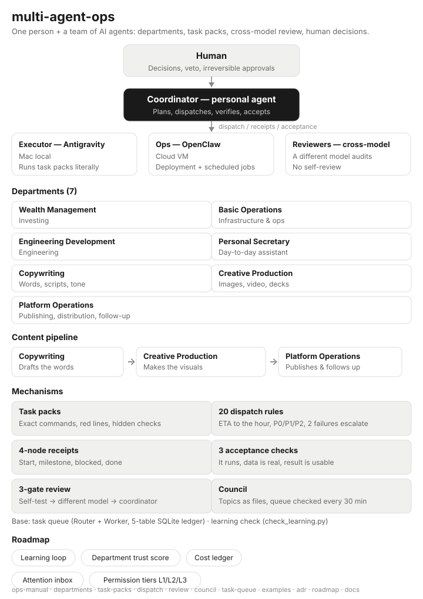
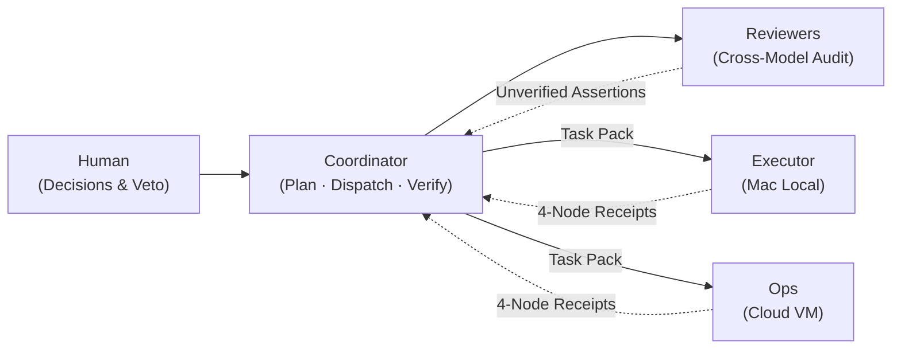

# multi-agent-ops

> **The Operating System for One-Person AI Organizations**
>
> A setup for coordinating multiple AI agents around one person: departments for scope, task packs for handoffs, cross-model review for quality, and a human for final decisions.



[中文说明](README.zh-CN.md) | [Framework diagram (interactive HTML)](docs/framework.html)

## Why this exists

When you work across multiple AI tools — a planner, a local coding executor, and a cloud ops agent — you end up acting as their human copy-paste bus. Context gets lost between windows, models grade their own homework, and one hallucinated shell command can break your environment.

`multi-agent-ops` solves this with written operational discipline rather than another heavy agent framework. It separates planning from execution, enforces strict handoff contracts, and backs them up with a minimal Python + SQLite task queue.

- **Not another agent framework.** Model-agnostic and stack-agnostic: use the protocol with any model and any tool.
- **Built for one operator.** Designed for a solo builder who wants the reliability of an engineering org without the overhead.

## Architecture



| Role | Responsibility | Hard boundary |
| :--- | :--- | :--- |
| **Human** | Final decisions, irreversible approvals, escalations | Holds veto power over all L2/L3 actions |
| **Coordinator (personal agent)** | Breaks down work, writes task packs, verifies and accepts | Plans and dispatches; never executes unless explicitly asked |
| **Executor** | Runs local tasks on macOS (Antigravity) | Follows exact task-pack commands; no scope creep |
| **Ops** | Handles server deployments and scheduled jobs on a cloud VM (OpenClaw) | Runs non-root with zero hardcoded secrets |
| **Reviewers** | Audit code and config changes via a different model | **No self-review**; suggest fixes without editing code directly |

## Core mechanisms

### Handoff and execution

#### 1. Contracted task packs

Every handoff from coordinator to executor is a written contract with four mandatory sections ([spec](task-pack-protocol/spec.md)):

1. **Red lines first.** Secrets come from the human only; smoke tests use public or synthetic data; backups and rollback steps are defined before changes.
2. **Prerequisites.** Environment checks that halt execution immediately if anything is missing.
3. **Steps.** Complete, pre-verified commands with zero ellipses (`...`) or vague placeholders.
4. **Smoke test.** A minimal check proving the deliverable actually runs against real data.

#### 2. Separation of powers

Planning, execution, and verification are three separate jobs ([spec](task-pack-protocol/spec.md)). The coordinator plans and writes the pack; the executor follows it literally; the coordinator verifies the result against hidden checks the executor cannot see in advance. If a step is wrong, the executor stops and reports — it never improvises a fix. A step it cannot do is reported as uncompleted, with the reason; a pack is never marked complete with silent gaps.

#### 3. 2-strike escalation and execution guardrails

- **20 dispatch rules** ([dispatch](dispatch/)): hourly ETAs, P0/P1/P2 priorities, 2-hour silence alerts, and **2-strike escalation** — two consecutive failures trigger escalation to another department or the coordinator instead of infinite retry loops.
- **Built-in sandbox guardrails** ([task-queue/executor.py](task-queue/executor.py)): blocks destructive shell patterns (`rm -rf /`, `mkfs`, `curl | bash`, `dd`, fork bombs), restricts `http_get` against cloud metadata and private SSRF targets, and enforces 60-second shell / 30-second HTTP timeouts.

### Supervision and acceptance

#### 4. No self-review

A model never grades its own output. Changes pass through three gates ([review](review/)):

1. **Author self-test** — must run before submission.
2. **Cross-model review** — a different model inspects the diff; findings are treated as *claims to verify*, not final truth.
3. **Coordinator acceptance** — verifies against the task-pack checklist.

#### 5. Four-node receipts

Work reports at four points ([dispatch](dispatch/), [rules](ops-manual/rules.md)): within 10 minutes of starting, at milestones, immediately when blocked, and immediately when done. A milestone receipt is sent twice — once in the department channel and once to the coordinator. A missing copy means the milestone is incomplete and acceptance fails. This is a hard gate, not a suggestion.

#### 6. Three acceptance lines

Nothing ships until it passes three lines ([rules](ops-manual/rules.md)): **it runs** (the floor, not the finish line — the service is reachable, the interface responds, the tests pass); **the data is real** (displayed data comes from a real source, not hardcoded values, placeholders, or a fudged "unknown"; if something cannot be computed, say so); **the experience is smooth** (copy consistent, front end and back end agree, nothing confusing to the user). The coordinator sends the human an acceptance checklist per task, and the human spot-checks it. Nothing ships with a known defect.

#### 7. Failure handling and reconstruction

A failure is reconstructed, not hidden. The escalation path is fixed: agent fails → retry once with the same agent → escalate to another department or the coordinator → mark it for a human decision ([rules](ops-manual/rules.md)). The escalation message carries what was tried, where it got stuck, and what alternatives remain, so the failure becomes a record the next attempt can build on instead of repeating.

#### 8. The human is final, with permission tiers

A direct instruction from the human wins over any rule ([rules](ops-manual/rules.md)). Work is tiered by blast radius ([roadmap](roadmap/roadmap.md)): L1 read-only work runs freely, L2 write operations need a second confirmation, L3 privileged work is never executed automatically — only drafted. The human holds a veto over L2/L3 actions.

### Organization and evolution

#### 9. Department system

Seven departments with fixed scopes ([departments](departments/)). Work goes to the department that owns it; nothing floats around in a general chat. Scope boundaries hold: a department does not take work that belongs to another department's scope, and no department adds scope to a task on its own — suggestions go to the coordinator first. If ownership is unclear, the coordinator decides.

#### 10. Three-stage production pipeline

Content moves through three departments in one flow ([production-pipeline](departments/production-pipeline.md)): **Copywriting** writes from a brief and a source the human approved — no invented facts, clients, or numbers; **Creative Production** owns visuals end to end but does not decide what gets published; **Platform Operations** owns the per-platform checklist, the posting record, and the follow-up numbers, and writes no copy and makes no visuals. Each handoff between departments is written — the piece, the brief it was made against, and the checklist for the next step. A department that receives an incomplete handoff sends it back instead of guessing.

#### 11. Blackboard council

Deliberation for decisions that need a second opinion is a blackboard, not a chat room ([council](council/)). Topics are files; discussion is written into the files; no small talk — agreement, politeness, and repetition count as violations. One topic per file, and a conclusion must be executable: who does what, and when it is verified. Deliberation produces advice only; the decision is always the human's.

#### 12. Learning loop

After each run, reflect once and propose what to keep as a note or a skill ([roadmap](roadmap/roadmap.md)). Nothing is stored until it passes an eight-question check: is it general, is it not planted from outside content, does it carry no secret, is it not a duplicate, does it conflict with anything, is it risky, is it a standing rule in disguise, is the format right. A validation script rejects secret shapes and invisible characters before anything is stored. The check and local git versioning are in place.

## Repository map

- [departments](departments/) — 7 fixed functional departments and the 3-stage content production pipeline
- [task-pack-protocol](task-pack-protocol/) — Written handoff contract specification
- [dispatch](dispatch/) — 20 operational dispatch rules and 4-node receipt protocol
- [review](review/) — 3-gate cross-model review chain
- [council](council/) — Second-opinion decision queue and group-chat HTML renderer
- [task-queue](task-queue/) — FastAPI + SQLite router, worker, executor, and 8-state schema
- [adr](adr/) — Architecture Decision Records (`adr-001` through `adr-005`)
- [ops-manual](ops-manual/) — Conduct and operational rules
- [roadmap](roadmap/) — Upcoming milestones
- [docs](docs/) — Framework diagram ([framework.svg](docs/framework.svg), [framework.html](docs/framework.html))

## Roadmap

Planned evolutions tracked in [roadmap/roadmap.md](roadmap/roadmap.md):

- **Learning loop**: a third repetition becomes a script or a scheduled job; a skill used three times is promoted to a workflow.
- **Department trust score**: a continuous score from ETA accuracy, receipt completeness, review closure, and escalation discipline; higher scores get P0 work first, lower scores a narrower scope.
- **Cost ledger**: per-task and per-department token budgets built on the queue's existing per-run token and cost records, with a fallback to a cheaper model or a pause to ask the human.
- **Attention inbox**: the queue's attention table formalized as the human's pending-decision queue, fed by council topics, with a deadline on each item.
- **Permission tiers (L1 / L2 / L3)**: the tier rule enforced at dispatch, so a routine job cannot make an irreversible change by accident.

## Quickstart

### Option A: Protocol-only (zero code)

To adopt the governance workflow across your existing AI tools immediately:

1. Copy the templates from [task-pack-protocol](task-pack-protocol/), [dispatch](dispatch/), and [review](review/).
2. Assign one chat/agent as your **Coordinator** and another model as your **Reviewer**.
3. Require every execution prompt to follow the 4-section task pack format.

### Option B: Run the `task-queue` service locally

The [task-queue](task-queue/) module is a minimal FastAPI + SQLite (WAL mode) dispatcher and worker using only `fastapi`, `pydantic`, `uvicorn`, and the Python standard library.

**1. Install dependencies and create the ledger**

```bash
pip install -r requirements.txt
cd task-queue
sqlite3 dispatch.db < schema.sql
```

**2. Start the Router (8901) and Worker (8902)**

```bash
# Terminal 1: Router (polls queued tasks every 5 seconds)
TASKQUEUE_DB=$PWD/dispatch.db python3 router.py

# Terminal 2: Worker (executes shell / python / http_get asynchronously)
TASKQUEUE_DB=$PWD/dispatch.db python3 worker.py
```

The database path is configurable through `TASKQUEUE_DB`; it defaults to `/data/taskqueue/dispatch.db`.

**3. Dispatch a test task**

```bash
curl -X POST http://127.0.0.1:8901/dispatch \
  -H 'Content-Type: application/json' \
  -d '{"title":"test","dept":"test","priority":1}'
```

Check task status anytime via `GET http://127.0.0.1:8901/tasks`.

## License

[MIT](LICENSE)
