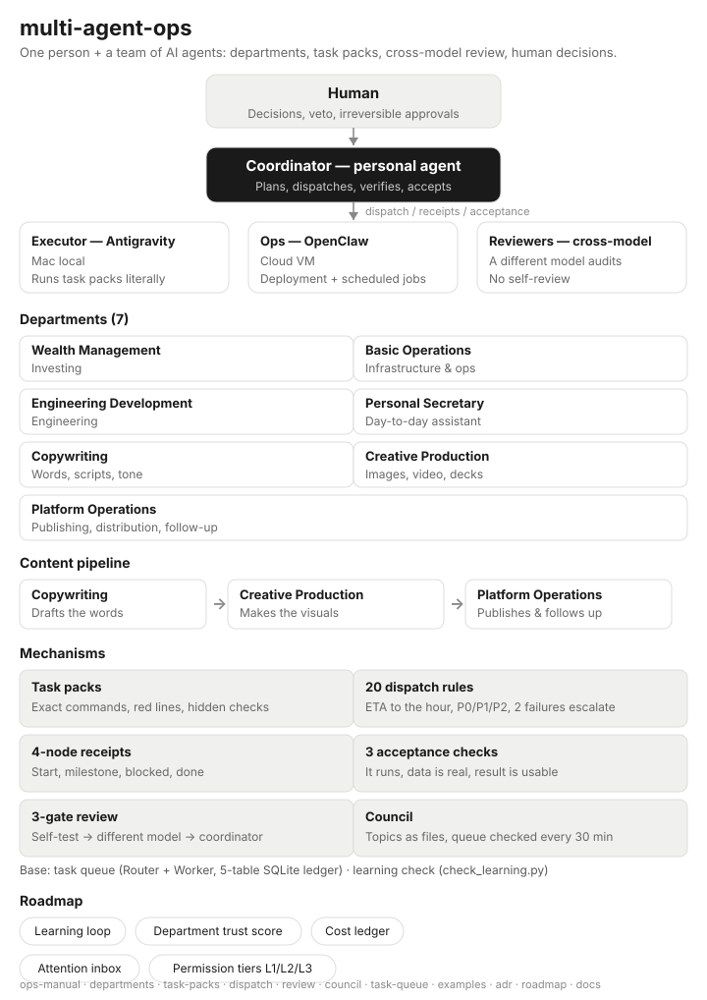
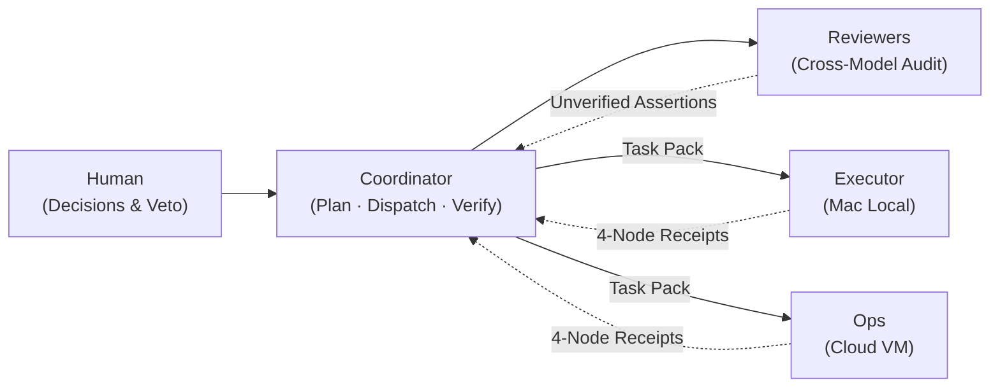

# multi-agent-ops（中文版）

> **面向超级个体与独立开发者的 AI 团队治理体系**
> **The Operating System for One-Person AI Organizations**
>
> 一套协调多个 AI 智能体围绕一个人工作的配置：部门管范围、任务包管交接、跨模型评审管质量、人做最终决策。



[English](README.md) | [框架图（交互式 HTML）](docs/framework.html)

注：这是 README.md 的中文翻译，仅供审阅；对外发布的仍是英文版。

## 为什么要有这个项目

同时用多个 AI 工具干活时——一个规划者、一个本地写代码的执行者、一个云端运维智能体——你最后会变成它们之间的人肉复制粘贴机。上下文在窗口之间丢失，模型给自己的作业打分，一条幻觉编出来的 shell 命令就能搞坏你的环境。

`multi-agent-ops` 用**书面化的运行纪律**而不是又一个重型智能体框架来解决这个问题。它把规划和执行分开，用严格的交接契约约束每一次移交，再用一套极简的 Python + SQLite 任务队列兜底。

- **不是又一个智能体框架。** 不绑定模型、不绑定工具栈：这套协议可以用在任何模型、任何工具上。
- **为一个人而建。** 为想要工程组织的可靠性、又不想背组织开销的独立开发者而设计。

## 架构



| 角色 | 职责 | 硬边界 |
| :--- | :--- | :--- |
| **人** | 最终决策、不可逆操作审批、升级接管 | 对所有 L2/L3 操作握有一票否决权 |
| **总协调 (personal agent)** | 拆解工作、写任务包、验货验收 | 只规划和派单，除非明确点名，不直接执行 |
| **执行者** | 在 macOS 本地跑任务（Antigravity） | 按任务包命令的字面意思执行，不擅自扩大范围 |
| **运维** | 云虚拟机上的服务端部署和定时任务（OpenClaw） | 以非 root 身份运行，零写死密钥 |
| **评审者** | 通过另一个模型审计代码和配置改动 | **禁止自审**；只提修改建议，不直接改代码 |

## 核心机制

### 交接与执行

#### 1. 契约化任务包

总协调交给执行者的每一次移交，都是一份书面契约，包含四个强制章节（[规范](task-pack-protocol/spec.md)）：

1. **红线在前。** 密钥只由人手工提供；冒烟测试只用公开或合成数据；改动之前先定好备份和回滚步骤。
2. **前置条件。** 环境检查，缺任何一项立即停下执行。
3. **步骤。** 完整、事先验过的命令，零省略号（`...`）、零模糊占位。
4. **冒烟测试。** 最小验证，证明交付物真的能对着真实数据跑起来。

#### 2. 规划、执行、验收三权分立

规划、执行和验收是三件分开的事（[规范](task-pack-protocol/spec.md)）。总协调规划并写任务包；执行者按字面执行；总协调对照执行者事先看不到的隐藏检查项验货。步骤错了，执行者停下汇报——绝不即兴修补；做不了的步骤如实报未完成并说明原因；任务包绝不带着悄悄留下的缺口标完成。

#### 3. 两次失败即升级与执行护栏

- **20 条派单规则**（[dispatch](dispatch/)）：ETA 精确到小时、P0/P1/P2 优先级、两小时无进展提醒、**两次失败即升级**——连续失败两次就自动升级（换部门或交总协调），而不是无限重试。
- **内置沙箱护栏**（[task-queue/executor.py](task-queue/executor.py)）：拦截危险 shell 模式（`rm -rf /`、`mkfs`、`curl | bash`、`dd`、fork 炸弹），限制 `http_get` 访问云元数据和内网 SSRF 目标，shell 60 秒、HTTP 30 秒超时强制执行。

### 监督与验收

#### 4. 禁止自审

一个模型永远不给自己的输出打分。改动要过三道关（[review](review/)）：

1. **作者自测**——提交之前必须先跑过。
2. **跨模型评审**——换一个模型检查改动；评审意见当作*待核实的说法*，不当最终结论。
3. **总协调验收**——对照任务包检查清单验货。

#### 5. 四节点进度回执

工作在四个节点汇报（[dispatch](dispatch/)、[规则](ops-manual/rules.md)）：开工 10 分钟内、里程碑、阻塞立即、完工立即。里程碑回执发两份——部门频道一份、总协调一份。缺一份就等于里程碑没完成，验收直接失败。这是硬门槛，不是建议。

#### 6. 三条验收线

三条线都过了才能出货（[规则](ops-manual/rules.md)）：**能跑通**（这是底线不是终点——服务可达、接口响应、测试通过）；**数据真实**（展示的数据来自真实来源，不是写死的值、占位符或凑出来的 "unknown"；算不出来就老实说）；**体验顺滑**（文案一致、前后端对得上、不让用户困惑）。总协调每项验收给人发一张核查清单，人抽查；带已知缺陷不许出货。

#### 7. 失败处理与重构

失败是拿来重构的，不是藏起来的。升级路径写死：智能体失败 → 同一智能体重试一次 → 升级到另一个部门或总协调 → 标给人裁决（[规则](ops-manual/rules.md)）。升级消息要写清试了什么、卡在哪、还剩什么备选，这样失败就成了一份记录，下一次尝试可以直接接着它重构，而不是从头再踩一遍。

#### 8. 人是最终裁决，权限分级

人的直接指令压过任何规则（[规则](ops-manual/rules.md)）。工作按破坏半径分级（[roadmap](roadmap/roadmap.md)）：L1 只读工作自由跑，L2 写操作要二次确认，L3 特权工作永不自动执行——只起草。人对 L2/L3 操作握有一票否决权。

### 组织与演进

#### 9. 部门制

7 个职能部门，各有固定范围（[departments](departments/)）。工作交给负责它的部门，不在公共聊天里漂着。范围边界守住：部门不接属于别的部门的工作，也不擅自给任务加范围——建议先交给总协调。归属不清时，总协调说了算。

#### 10. 三段式内容生产流水线

内容在一个流程里走过三个部门（[production-pipeline](departments/production-pipeline.md)）：**Copywriting** 按人批准过的 brief 和信源写字——不编造事实、客户或数字；**Creative Production** 负责视觉资产全流程，但不决定发不发；**Platform Operations** 负责各平台清单、发布记录和后续数据，不写文案也不做图。部门之间的每次交接都是书面的——作品本身、依据的 brief、给下一步的清单。收到不完整的交接就退回去，而不是靠猜。

#### 11. 黑板式 Council

需要第二意见的决策走黑板，不走聊天室（[council](council/)）。议题就是文件，讨论写进文件里；禁止寒暄——附和、客套、重复都算违规。一个文件只谈一个议题，结论必须能执行：谁、做什么、何时验。讨论只出建议，决定永远是人的。

#### 12. 学习回路

每轮跑完反思一次，提议哪些沉淀成笔记或技能（[roadmap](roadmap/roadmap.md)）。存之前必须过八问自查：通用吗、是不是被种进来的、含秘密吗、重复吗、冲突吗、有风险吗、是不是伪装的常驻规则、格式对吗。校验脚本在入库前拦住密钥形状和不可见字符。自查和本地 git 版本管理已经就位。

## 仓库目录

- [departments](departments/)——7 个固定职能部门和三段式内容生产流水线
- [task-pack-protocol](task-pack-protocol/)——书面交接契约规范
- [dispatch](dispatch/)——20 条运行派单规则和四节点回执协议
- [review](review/)——三道关的跨模型评审链
- [council](council/)——第二意见决策队列和群聊 HTML 渲染器
- [task-queue](task-queue/)——FastAPI + SQLite 的 Router、Worker、执行器和 8 状态 schema
- [adr](adr/)——架构决策记录（`adr-001` 至 `adr-005`）
- [ops-manual](ops-manual/)——行为准则和运行规则
- [roadmap](roadmap/)——后续计划
- [docs](docs/)——框架图（[framework.svg](docs/framework.svg)、[framework.html](docs/framework.html)）

## Roadmap

后续演进见 [roadmap/roadmap.md](roadmap/roadmap.md)：

- **学习回路**：第 3 次重复就固化成脚本或定时任务；用过 3 次的技能晋升为工作流。
- **部门信任分**：按 ETA 准确率、回执完整度、评审闭环和升级纪律连续打分；分高的先拿 P0，分低的范围收窄。
- **成本账本**：在队列已有的每轮 token 与成本记录上加按任务、按部门的预算，超了自动降级模型或停下问人。
- **注意力收件箱**：把队列的注意力表正式化为人的待决策队列，由 Council 议题喂进来，每项带截止时间。
- **权限分级（L1 / L2 / L3）**：在派单时执行分级规则，让常规任务没机会误做不可逆改动。

## 快速上手

### 方案 A：只套用协议（零代码）

想立刻在你现有的 AI 工具里用上这套治理流程：

1. 复制 [task-pack-protocol](task-pack-protocol/)、[dispatch](dispatch/) 和 [review](review/) 里的模板。
2. 指定一个对话/智能体做**总协调**，另一个模型做**评审者**。
3. 要求每一次执行提示都按四章节任务包格式写。

### 方案 B：在本地跑 `task-queue` 服务

[task-queue](task-queue/) 模块是一套极简的 FastAPI + SQLite（WAL 模式）派单器和 Worker，只用 `fastapi`、`pydantic`、`uvicorn` 和 Python 标准库。

**1. 安装依赖并建账本**

```bash
pip install -r requirements.txt
cd task-queue
sqlite3 dispatch.db < schema.sql
```

**2. 启动 Router（8901）和 Worker（8902）**

```bash
# 终端 1：Router（每 5 秒轮询待处理任务）
TASKQUEUE_DB=$PWD/dispatch.db python3 router.py

# 终端 2：Worker（异步执行 shell / python / http_get）
TASKQUEUE_DB=$PWD/dispatch.db python3 worker.py
```

数据库路径通过 `TASKQUEUE_DB` 环境变量配置，默认是 `/data/taskqueue/dispatch.db`。

**3. 派一个测试任务**

```bash
curl -X POST http://127.0.0.1:8901/dispatch \
  -H 'Content-Type: application/json' \
  -d '{"title":"test","dept":"test","priority":1}'
```

随时用 `GET http://127.0.0.1:8901/tasks` 查看任务状态。

## License

[MIT](LICENSE)
